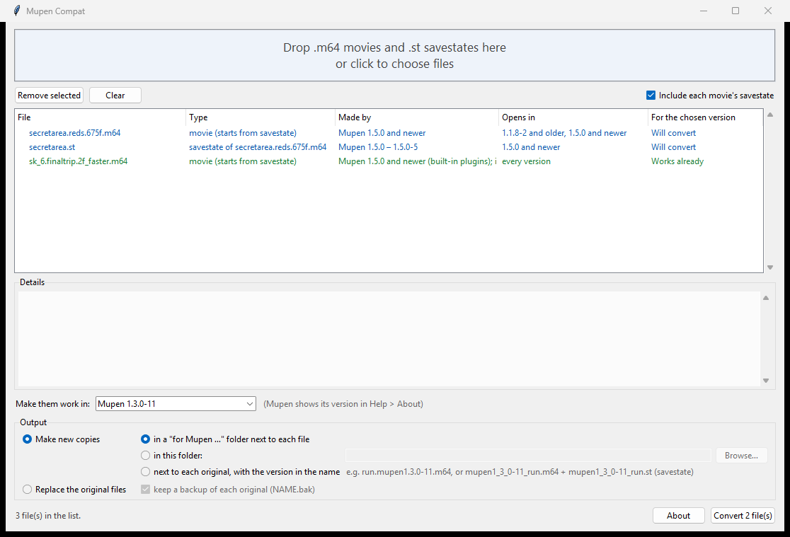

# Mupen Compat

**Make your Mupen64 TAS movies (`.m64`) and savestates (`.st`) work in older versions of Mupen64-rr-lua.**

Sent someone a savestate or movie and their Mupen says the savestate is *"from another ROM"*, or that *"the movie's
extended version is invalid"*? Their Mupen is older than yours. Newer Mupens save files in a slightly different
format that older ones can't read. Mupen Compat makes a copy they *can* read, in a couple of clicks.



## Download

1. Go to the [**Releases**](../../releases/latest) page.
2. Download **`MupenCompat.exe`**.
3. Run it. Nothing to install.

> **"Windows protected your PC"?** Windows shows this for new programs that aren't signed by a big company.
> Click **More info**, then **Run anyway**. (The whole source code is in this repository if you'd like to check it
> or build it yourself.)

## How to use it

1. **Drop your files on the window**: movies, savestates, or a whole folder. You can also click the big box to
   pick files. When you add a movie, its savestate comes along automatically.
2. **Choose the Mupen version** the files need to work in, under *Make them work in*.
   Not sure which version someone has? In Mupen it's under **Help → About**.
   *Every version (most compatible)* makes files that work in all of them.
3. **Press Convert.**

The list tells you what each file is, which Mupen made it, which versions can already open it, and whether it needs
converting for the version you picked:

| Status | Meaning |
|---|---|
| **Works already** | Nothing to do: that version opens it as it is. |
| **Will convert** | A copy will be made that the chosen version can open. |
| **Works (see note)** | It opens, but read the note in the details (for example a setting to match). |
| **Problem** / **Unreadable** | It isn't a Mupen movie or savestate, or it's damaged. |

Click a file to see everything about it in the *Details* box.

## Where the converted files go

Your original files are never changed unless you ask for it. Pick one:

- **In a "for Mupen …" folder next to each file** (the default), e.g. `for Mupen 1.3.0-11\`. Same file names.
- **In this folder:** any folder you choose.
- **Next to each original, with the version in the name**, e.g. `run.mupen1.3.0-11.m64` or
  `mupen1_3_0-11_run.st`. Mupen finds a movie's savestate by its name, so the names are chosen so that each new movie
  still loads the right savestate.
- **Replace the original files.** A backup (`.bak`) of each original is kept unless you untick it.

Only files that need it are written. A movie and its savestate are treated as a pair: if either one needs
converting, both are written together so they keep finding each other; if both already work, nothing is written.

## What it changes, and what it doesn't

It only changes the *file format*, never your inputs or the game state:

- **Savestates from Mupen 1.5.0 and newer** are compressed in a new way (LZ4). Older Mupens can't read that and
  think the savestate belongs to a different ROM. Mupen Compat re-compresses them the old way (gzip), which every
  version reads. The contents stay exactly the same.
- **Movies from Mupen 1.5.0 and newer** have a newer header that Mupen 1.1.9 to 1.4.0-8 refuse to open. Mupen Compat
  writes the older header. Every input stays the same.
- **Savestate screenshots** (an optional setting) changed in 1.4.0. They're removed for older versions; the game
  picture comes back on the next frame.

## Will the movie stay in sync?

For Super Mario 64 and its hacks, yes: converted movies were tested in the real emulators (1.1.8 through 1.5.0-6)
and matched the original frame for frame. Older movies also play the same in new versions.

Sync can still depend on emulator **settings**. When a movie says it was recorded with a special setting that
older versions can't read from the file (like the counter factor or RCP lag), the details tell you which setting to
match by hand.

**Plugins:** Mupen never switches plugins for a movie. The plugin names stored in a movie are just a record. Each
Mupen version needs its own plugin files (the 1.5 plugins are built into its .exe and can't be copied to an older
version).

## Questions

**Which Mupen versions does it know?** Every Mupen64-rr-lua release from 1.0.0 to 1.5.0-6.

**Can it make old files work in new versions?** New versions already open old files, so there's nothing to convert.

**Is my file safe?** Mupen Compat only reads your files, and writes new ones where you choose. With *Replace*, a
`.bak` backup is kept by default.

**Something didn't work?** Please [open an issue](../../issues) with the file and the Mupen version.

## For developers

Python 3.10+ on Windows, no extra packages:

```
python MupenCompat.pyw                          # the window
python -m mupencompat --report FILE...          # analyse files in the terminal
python -m mupencompat --convert --target 1.3.0-11 FILE...
python -m unittest tests/test_formats.py        # tests
python build.py                                 # builds dist/MupenCompat.exe (needs pyinstaller and pillow)
```

[FORMATS.md](FORMATS.md) is the technical write-up: what changed in each Mupen release and the test results.

## Licence

MIT, see [LICENSE](LICENSE). Mupen64-rr-lua is a separate project: [mupen64/mupen64-rr-lua](https://github.com/mupen64/mupen64-rr-lua).
